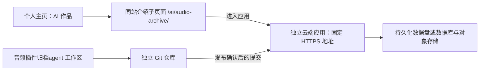

# 效果器档案室的独立部署与主页接入

日期：2026-11-06。状态：方案已提出；主页入口与介绍子页面已在本地实现；应用尚未云端部署。本轮没有修改另一工作区。

## 希望保持的使用方式

个人主页管理作品展示，“音频插件归档agent”工作区管理应用。应用以后仍在 `E:/Tools/音频插件归档agent` 独立修改、预览、发布；无需将整套代码复制回主页。

当前本地入口：`http://127.0.0.1:4180/ai/audio-archive/`。
随主页正式发布后，入口将是 `https://huangyd.is-a.dev/ai/audio-archive/`。这不是已经发布成功的声明。

## 现有代码的实际情况

- 主页为 Sites 静态站点，发布目录是 `dist/`。
- 应用是 Python 3.12+ / FastAPI，依赖 PyMuPDF 读取 PDF，有 SQLite 索引、磁盘文件、后台分析任务、模型接口和飞书授权。
- `src/audio_archive/api.py` 的可信主机只有 localhost/127.0.0.1，响应头 `frame-ancestors 'none'` 禁止被网页嵌入；写请求校验同源和自定义请求头。这些本机限制不是云端身份认证。
- `src/audio_archive/config.py` 已提供 `AUDIO_ARCHIVE_DATA` 数据目录配置；默认飞书回调仍是本机地址。
- 项目当前没有 Git 仓库；`data/` 包含真实档案、配置、授权令牌等，不能作为公开源码或静态网页直接上传。本轮只读取了源码与说明，未读取或复制这些凭证。

## ADR-001：固定作品入口，应用独立运行

状态：推荐，待云端实施阶段确定服务商和访问范围。

推荐结构：

这使作品介绍成为真正的主页子页面；“进入应用”打开独立应用，届时浏览器地址会改变。它并不把 Python 服务伪装成主页内已经运行的功能。

主页仅有一个接入配置：`dist/ai/audio-archive/project.json` 的 `launchUrl`。现在是 null，页面如实显示“本地应用 · 云端版尚未开放”，不显示失效按钮。云端应用通过验收后，把它填成实际、稳定、无凭证的 HTTPS 地址，再发布主页一次。应用后续只要保持该地址，重新部署应用即可，主页不用再次发布。

可以使用服务商提供的地址先跑通；自定义子域名是可选项，需要另行核验 DNS 与服务商绑定，当前不假定任何子域名已可用。

### 可选方案与取舍

| 方式 | 地址与体验 | 后续维护 | 本项目的条件 |
| --- | --- | --- | --- |
| 固定子页面 + 打开独立应用（推荐） | 介绍页在个人域名，进入应用后换地址 | 两个项目各自部署；主页仅存固定地址 | 改动最小，登录和飞书跳转更直接 |
| 子页面 iframe 展示公开演示 | 浏览器保留个人主页路径 | 应用独立部署 | 必须修改应用的 frame-ancestors 为主页的准确来源；还需验证登录、第三方 cookie、移动端高度与失败提示。当前禁止嵌入，不能直接套 iframe |
| 同一域名路径反向代理 | 应用本身也位于个人域名路径 | 两边仍独立发布，但多一层代理 | 主页需从纯静态托管升级到有服务端路由的部署；应用调整 root_path、绝对资源/API 路径、Cookie、HTTPS/代理头与 OAuth 回调。仅设置 CNAME 不能按路径分流 |

如果必须让整个应用始终显示为 `huangyd.is-a.dev/ai/audio-archive/`，应选择第三种并单独实施，不应把第一种叫作同源应用。

## 另一工作区的实施清单

1. **确定公开范围**：推荐访客看脱敏的只读演示/示例，归档、修改、模型调用、设置和飞书同步仅登录后的所有者可用。若要让每个访客上传自己的手册，则需要用户隔离、配额、存储生命周期等额外设计，不能共享当前单用户数据目录。
2. **建立独立源码仓库**：只纳入源码、依赖说明、测试、经过核查的演示内容和部署配置；排除整个 `data/`、`.env`、本机缓存、授权文件、原始手册与未确认可公开的材料。不要直接上传工作区整包。
3. **容器化运行**：可使用官方 Python 基础镜像构建 FastAPI 容器。按当前结构复制 `src/`、`web/` 及实际需要的 prompts，安装 pyproject 依赖；服务监听 `0.0.0.0` 与平台指定端口。初期单实例/单 worker，兼容现有文件锁、SQLite 和后台任务设计。
4. **选择带持久化存储的 Python/Docker 托管**：例如 Render 的容器服务加持久磁盘，或已有云服务器；服务商尚未选定，也没有开通付费资源。将 `AUDIO_ARCHIVE_DATA` 指向挂载盘。不要依赖部署时会清空的临时文件系统。备份后验证重启与重新部署不丢档案。
5. **完成云端改造**：配置允许的实际域名；保留同源校验；给所有私有 API 加身份和权限校验；公开页面只读取明确的公开数据。限制上传大小、并发、任务与模型调用费用。API Key、飞书密钥放服务端密钥配置，OAuth 令牌与用户数据放受保护的持久存储，不能传到主页配置。
6. **改造授权与任务恢复**：飞书回调改为实际 HTTPS 地址并在飞书后台登记；核验 OAuth state/会话绑定。处理中任务需要可恢复状态，发布期间不重复同步、不悄悄丢任务。按已实现的单实例策略验证重启与中断恢复，再考虑增加实例。
7. **独立发布验收**：先预览，用户要求发布时再部署选定提交。验收登录前无法读取私有档案/设置或触发写操作；读写、上传、归档、实际授权与同步可用；重启后数据保留；日志不含密钥；关闭本机后仍可访问云端应用。通过后提供固定 URL 与发布提交号。
8. **接回主页**：在本工作区设置 `launchUrl` 并按用户要求发布主页。此后另一工作区继续单独迭代、测试、发布和回滚，固定网址不变。

持续部署建议保留“修改 → 本地预览 → 确认版本 → 发布”的节奏。可让云端只跟踪 release 分支，避免每次本地保存或试验提交都直接改变公开应用。具体发布自动化在选定服务商后配置。

## 可复制到另一工作区的任务说明

> 请把当前“效果器档案室”准备成可独立部署的云端应用，保留本工作区作为唯一应用源码来源。个人主页已建立固定作品子页面 `/ai/audio-archive/`，后续会链接你的固定 HTTPS 地址，无需复制应用源码到个人主页。请先完成云端改造与预览，待我要求时再正式发布。核验现有 FastAPI / SQLite / PDF / 飞书流程；补充身份权限、数据持久化、服务端密钥、HTTPS 回调与任务恢复。公开演示和私有管理应隔离，不上传 data/、令牌、个人档案或未经确认的手册。初期以单实例运行，保持后续版本网址不变；交付可回滚的发布流程、通过验收的 URL 和提交号。完整接入方案位于个人主页工作区 `sites/huangyd-portfolio/docs/audio-archive-integration.md`。

## 资料依据

- FastAPI 官方容器部署：https://fastapi.tiangolo.com/deployment/docker/
- FastAPI 路径前缀与反向代理：https://fastapi.tiangolo.com/advanced/behind-a-proxy/
- Render 持久磁盘（需支持磁盘的付费服务；未申请）：https://render.com/docs/disks
- iframe 嵌入许可 `frame-ancestors`：https://developer.mozilla.org/en-US/docs/Web/HTTP/Reference/Headers/Content-Security-Policy/frame-ancestors

当前本地 Sites 技能声明其服务端代码运行于 Cloudflare Workers；现有 Python/FastAPI/PyMuPDF/磁盘服务不能当作静态文件或未经改造的 Worker 直接上传运行。
